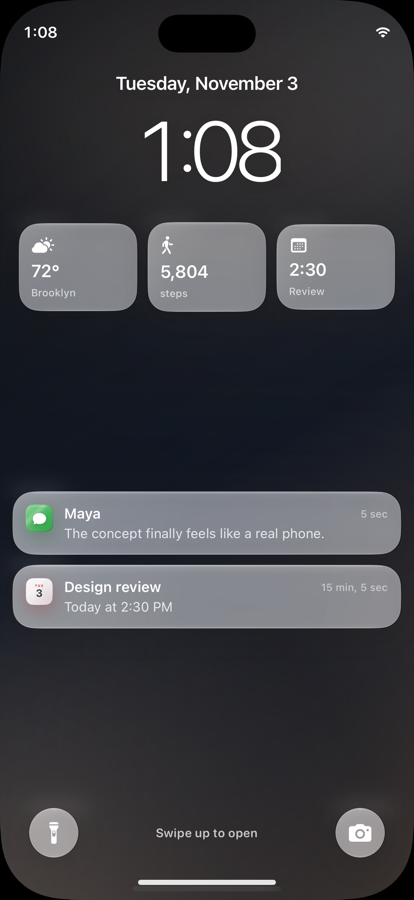
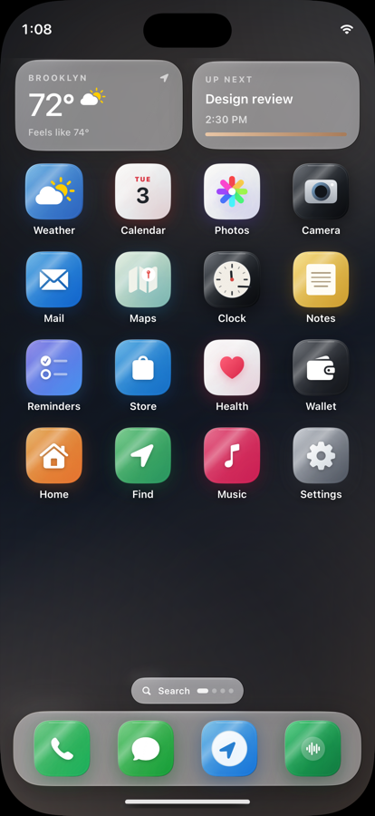
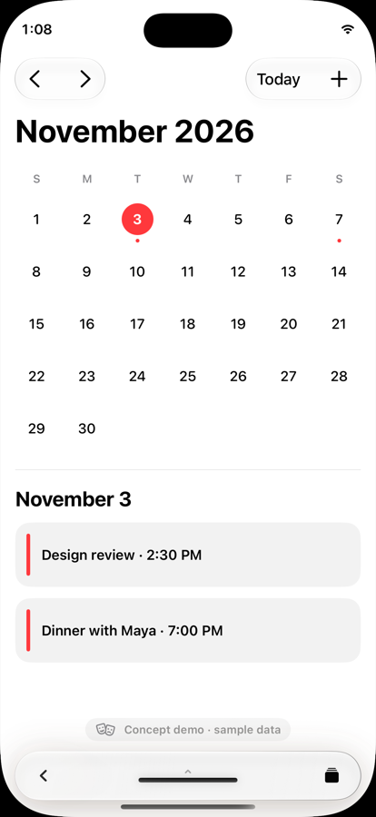
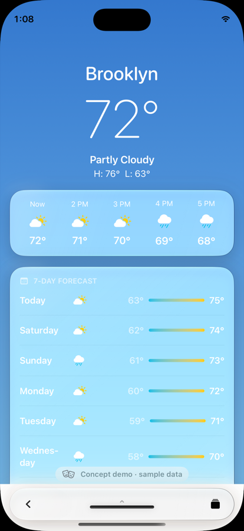

# Swift UI

*Formerly Indica OS.* A native iPhone app that hosts a complete phone-interface environment: lock screen, launcher, search, app switching, notification and control panels, settings, and 50 embedded apps.

Swift UI runs inside an ordinary iOS application. It does not replace the operating system. Some apps store your data locally, some connect to external services, and others are concept demos that use sample data. Concept demos are labeled **Concept demo · sample data** on screen, and [docs/audit/app-inventory.md](docs/audit/app-inventory.md) lists the status of every app.

The visual redesign has not started yet, so the current look is the earlier prototype's, including the old boot mark. The app's name and copy now say Swift UI; the project, bundle ID and callback keep their `IndicaOS` names for compatibility. See [CHANGELOG.md](CHANGELOG.md) for what changed in each release.

<p>
  
  
  
  
</p>

*v0.2.0 captures from the iPhone 18 Pro simulator, iOS 27.2. The earlier prototype's screenshot is kept at `docs/images/home.png` for history.*

## Run

Requires Xcode 26 or newer with an iOS SDK. The deployment target is iOS 17; native glass effects use an availability-guarded iOS 26 path, with a material fallback on earlier runtimes.

1. Open `IndicaOS.xcodeproj`.
2. Select the shared `IndicaOS` scheme and an iPhone simulator.
3. Run. A simulator build does not require a signing team. For a physical device, choose your own team and bundle identifier in Signing & Capabilities.

```sh
xcodebuild -project IndicaOS.xcodeproj -scheme IndicaOS \
  -sdk iphonesimulator -configuration Debug CODE_SIGNING_ALLOWED=NO build
```

v0.3.0 was built with Xcode 27.2 and exercised on the iPhone 18 Pro simulator (iOS 27.2). The calculator, pager and local logic checks pass, and the GitHub workflow runs them and builds the app on Xcode 26. It has not yet been tested on a physical iPhone or on the iOS 17 runtime.

## What is implemented

| Area | Behavior |
| --- | --- |
| Shell | Boot, lock, home pages that follow your finger, Search pill page scrubbing, app switching with swipe-to-close, overlays, search, and navigation |
| Local state | Notes (saved as you type), reminders, messages, journal entries, Canvas drawings, and appearance preferences stored on device; sample content is kept separate and can be removed without touching yours |
| Local apps | Calendar, Clock, Files and Voice Memos work with real data and system features, saved on this iPhone |
| Search | Finds apps and notes from the Search pill or the page-two search row |
| Device status | Network type and battery level from public iOS APIs; values iOS doesn't share are not shown |
| Handoffs | Mail drafts open in the system mail app, the keypad dials through the Phone app, and Gmail, YouTube and Outlook open their own apps |
| Calculator | Tested immediate-execution arithmetic, decimal input, clear, sign, percentage, and division errors |
| Spotify | PKCE sign-in, profile, top tracks, and one refresh/retry when an access token expires |
| Assistant connections | Developer API request flows using credentials in the device Keychain |
| Other service entries | Setup information and links where an integration is not implemented |
| Demo apps | Sample data and simulated behavior for views such as wallet, health, devices and passwords |

The demo password vault has no real authentication and accepts no real secrets. The app only declares the permissions it uses: the microphone for Voice Memos, plus the notifications prompt for Clock.

## Connections

Spotify requires your own developer client ID. Configure it in Settings → Developer Integrations and register `indicaos://oauth/spotify` as the redirect URI. Account eligibility and developer app access are controlled by Spotify. Tokens remain in the device Keychain.

OpenAI and Anthropic screens use developer API credentials and configurable model identifiers. Consumer subscriptions and chat histories are separate. Keys must be entered at runtime; none belong in this repository. API calls may incur provider charges.

Disconnecting removes the corresponding local credentials. Network flows have not been exercised against live accounts in this release review.

## Code map

| File | Responsibility |
| --- | --- |
| `SystemModels.swift` | Shell state, settings, and local models |
| `SystemShell.swift` | Launcher, overlays, icons, and shared surface styling |
| `CoreApps.swift`, `EverydayApps.swift` | In-app views |
| `CalculatorEngine.swift` | UI-independent arithmetic state machine |
| `Connections.swift` | Service configuration, OAuth, Keychain, and network requests |
| `SettingsSystem.swift` | Settings navigation and controls |
| `ContentView.swift`, `Haptics.swift` | Root environment and feedback |

OS text-size preferences, Reduce Motion, and Reduce Transparency are respected alongside the app's own controls. Accessibility across every simulated app still needs a device/simulator review, especially at the largest text sizes.

## Tests and release checks

```sh
swiftc IndicaOS/CalculatorEngine.swift Tests/CalculatorTests.swift -o /tmp/calculator-tests
/tmp/calculator-tests
```

The arithmetic engine is shared by the app and these tests. The checks cover operator replacement, chaining, repeated equals, decimals, negative backspace, clear, percentage, and division-by-zero recovery. See [the release checklist](docs/release-checks.md) for remaining simulator and account verification.

MIT licensed source. Apple, Spotify, and other service names identify referenced platforms. Their marks, system artwork, and third-party content are not relicensed by this project. Indica is an independent prototype.
